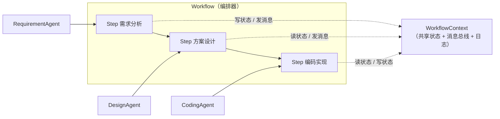
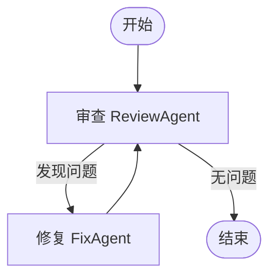

# Design.md —— 架构与设计说明

## 1. 项目目标

搭建一个 2~3 个 Agent 协作的简单 Workflow MVP，理解并演示三个核心概念：

1. **Workflow 编排** —— 把多个 Agent 组织成有向的执行流程；
2. **Agent 间通信** —— 通过消息传递与共享状态进行协作；
3. **状态管理** —— 统一的上下文对象维护流程状态并支持追踪。

## 2. 总体架构



- **Workflow（编排器）**：持有节点列表，按顺序调度，统一处理状态与日志。
- **Node（节点）**：`Step` / `LoopStep` / `ParallelStep`，提供顺序、条件、循环、并行四种控制。
- **Agent（执行单元）**：实现 `run(ctx)`，从上下文读取输入、写入输出、发送消息。
- **WorkflowContext（上下文）**：贯穿全流程的共享对象，解耦 Agent 之间的直接依赖。

## 3. 模块职责

| 模块 | 文件 | 职责 |
|------|------|------|
| 上下文 | `workflow/context.py` | `WorkflowContext`、`Message`、`WorkflowStatus`、日志与状态追踪 |
| Agent 基类 | `workflow/agent.py` | 定义 `run(ctx)` 与 `send()` 契约 |
| 编排引擎 | `workflow/engine.py` | `Step` / `LoopStep` / `ParallelStep` / `Workflow` |
| 具体 Agent | `workflow/agents.py` | 需求 / 设计 / 编码 / 审查 / 修复五类 Agent |

## 4. 关键设计决策

### 4.1 共享状态 + 消息传递双通道

- **共享状态（`ctx.state`）**：适合"数据流"式协作——上游产出、下游消费。
- **消息传递（`ctx.messages`）**：适合"事件/指令"式协作——显式通知下游，可追溯、可审计。

两者互补：状态承载数据，消息表达协作意图。

### 4.2 编排与执行解耦

`Workflow` 只负责"何时、以何种控制结构运行谁"，`Agent` 只负责"做什么"。新增 Agent 或调整流程无需改动引擎：

```python
# 新增一个 Agent，只需实现 run(ctx)
class NewAgent(Agent):
    def run(self, ctx):
        return {"result": "..."}

# 把它插进流程任意位置即可
wf.step("新步骤", NewAgent())
```

### 4.3 节点状态机

每个节点在 `WorkflowStatus` 状态机中流转：

```
PENDING → RUNNING → SUCCEEDED
                 ↘ FAILED（重试耗尽后按 on_error 策略处理）
条件不满足 → SKIPPED
```

完整状态记录在 `ctx.node_states`，可导出 JSON 用于审计与复现。

### 4.4 确定性实现、可替换为真实 LLM

本 MVP 的 Agent 采用**规则驱动**实现，保证零依赖、可离线运行、结果可复现。若要接入真实大模型，仅需替换 `Agent.run` 内部实现，框架层完全不变，满足"可扩展性"要求。

## 5. 流程示例

### 5.1 Mini SE 流程（顺序，主演示）

```
需求分析 → 方案设计 → 编码实现 → （编译 + 冒烟测试自检）
```

### 5.2 代码审查流程（循环 + 条件，进阶演示）



循环由 `LoopStep` 实现：只要 `review_issues` 非空就继续"审查→修复"，并受 `max_iterations` 上限保护。

## 6. 扩展性说明

- **新增 Agent**：继承 `Agent`，实现 `run(ctx)`，插入流程任意位置。
- **修改流程**：调整 `wf.step(...)` / `wf.loop(...)` / `wf.parallel(...)` 的组合即可。
- **接入 LLM**：替换具体 Agent 的实现，不影响编排层。
- **可视化编排（可选）**：`ctx.to_dict()` 已暴露完整拓扑与执行记录，可据此渲染编排界面。

## 7. 运行与测试

```bash
python main.py                              # Mini SE 流程演示
python examples/code_review_flow.py         # 代码审查循环演示
python -m unittest discover -s tests -v     # 单元测试
```
